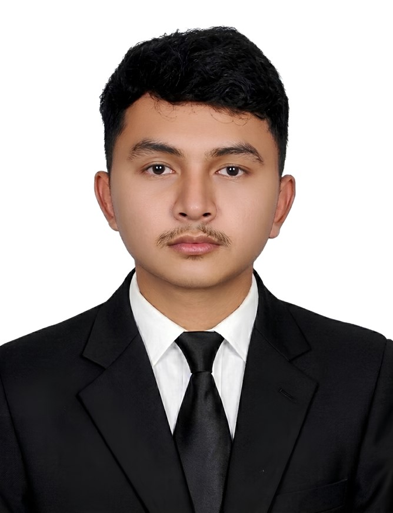

# PHEN CHETRA | IT Support Specialist & Developer

  

<h3 align="center">IT Support Specialist | Backend Developer | Full-Stack Developer</h3>

  Passionate about IT support, troubleshooting, database management, and building reliable web applications.

  <a href="https://chetraph.github.io/phen-chetra-portfolio/">
    <strong>🌐 View My Portfolio</strong>
  </a>

---

## 👨‍💻 About Me

Hello! I'm **Phen Chetra**, an Information Technology student at Build Bright University, Cambodia.

I am passionate about IT support, hardware and software troubleshooting, database administration, and web application development. I enjoy solving technical problems, improving system reliability, and developing practical software solutions.

My goal is to grow as an **IT Support Specialist** while continuing to strengthen my backend and full-stack development skills.

- 🎓 **Education:** Bachelor of Information Technology — Build Bright University
- 💼 **Primary Career Interest:** IT Support Specialist
- 🛠️ **Additional Interests:** Backend Development & Full-Stack Development
- 📍 **Location:** Phnom Penh, Cambodia
- 🌱 **Currently Improving:** System Troubleshooting, Networking, SQL, and Web Development

---

## 🛠️ Technical Skills

### IT Support & Infrastructure
- PC and Laptop Hardware Troubleshooting
- Software Installation, Configuration, and Maintenance
- Network Fundamentals and Troubleshooting
- IT Inventory and Technical Documentation
- Data Verification and Problem Solving

### Programming & Web Development
- C#
- ASP.NET
- Laravel
- HTML, CSS, and JavaScript

### Database Management
- MySQL
- Microsoft SQL Server
- Database Design
- CRUD Operations and Data Validation

### Productivity Tools
- Microsoft Office
- Google Workspace
- Visual Studio
- Visual Studio Code
- Git and GitHub

---

## 🚀 Featured Projects

### 1. IT Hardware & Software Support
Provided technical support through hardware and software troubleshooting, system maintenance, configuration, and IT inventory management.

### 2. Molten Iron Slag Recognition & Desulfurizer Prediction System
Worked on a project involving computer vision and machine learning for slag recognition and desulfurizer prediction.

### 3. Full-Stack Web Applications
Developed web applications using ASP.NET and Laravel, including CRUD functionality, database integration, and user management.

---

## 💼 Experience

- **IT Technical (Software & Hardware)** — BCS Computer
- **Product Specialist** — AWS Cambodia LTD
- **Full Stack Laravel Intern** — Build Bright University
- **Full Stack ASP.NET Intern** — MIS Team, Build Bright University
- **IT Support Intern** — Build Bright University

---

## 🎓 Education & Certifications

**Bachelor of Information Technology**  
Build Bright University (2023–Present)

Relevant Courses:
- Cyber Security of Web Applications
- Client/Server Application Development
- C# Programming

---

## 🌐 Languages

- Khmer — Native
- English — Intermediate / Good Working Proficiency

---

## 📫 Contact Me

I'm open to opportunities related to IT support, technical support, backend development, and full-stack development.

- **Email:** [chetraphen00@gmail.com](mailto:chetraphen00@gmail.com)
- **Phone:** (+855) 70 393 435
- **Location:** Phnom Penh, Cambodia
- **Portfolio:** [chetraph.github.io/phen-chetra-portfolio](https://chetraph.github.io/phen-chetra-portfolio/)

---

  <strong>Thank you for visiting my profile!</strong>

  Built with dedication by Phen Chetra.

